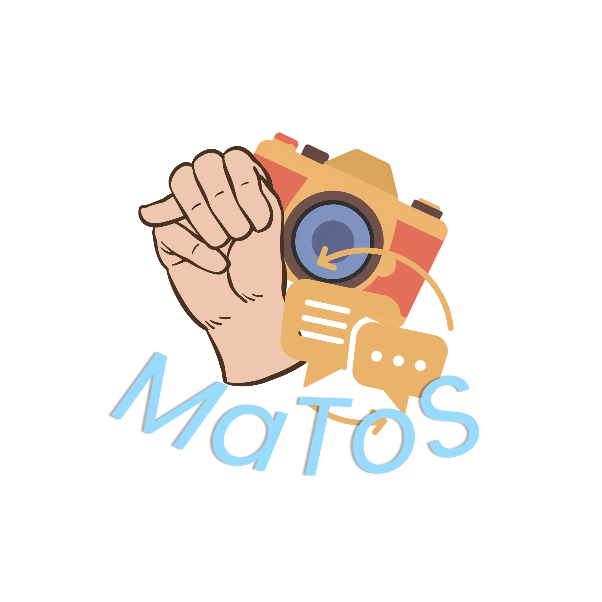
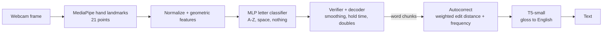

# MaToS



**MaToS** is a sign language recognition and translation system. It reads fingerspelled ASL from a webcam using hand landmarks, repairs the spelling, and uses a small T5 model to turn the result into English text. Everything runs on a CPU.

---

## How it works



1. **Landmarks:** MediaPipe finds the hand and returns 21 3D points per frame.
2. **Classifier:** an MLP predicts a letter (A–Z), `space`, or `nothing` from normalized landmark features.
3. **Decoder:** a time-based decoder turns a stream of predictions into letters, words and sentences.
4. **Autocorrect:** a weighted edit-distance corrector fixes misread or missing letters using a word-frequency dictionary and a custom names list.
5. **T5-small:** a fine-tuned model converts the corrected gloss into a natural English sentence.

---

## Requirements

- Python **3.11.9**
- Internet access for the first setup (hand model and dataset downloads)
- A webcam (optional; only needed for live testing and capturing your own data)
- A GPU environment (optional; recommended only for fine-tuning T5)

Install the dependencies:

```bash
pip install -r requirements.txt
```

---

## Training pipeline

Run these from the project root unless noted.

### 1. Go to the training directory

```bash
cd training
```

### 2. Download the hand landmarker model

```bash
python -m matos models
```

### 3. Download the Kaggle dataset

```bash
python scripts/kaggle_dataset.py
```

### 4. Extract the dataset into landmark shards

```bash
python -m matos extract --src kaggle="<KAGGLE FILE LOCATION>" --out shards
```
> **Note:** There's a prompt from step 3 if you want the default fallback.

### 5. Train the shards into a bundle

```bash
python -m matos train --shards shards --out base/bundle --seeds 3 --features xyz_geo --synth-nothing auto
```

> **Note:** If this is your first time, keep `--out base/bundle` so the program can fall back to it.

### 6. Build the dictionary

```bash
python scripts/build_dictionary.py
```

> You can edit the script to customize the dictionary (size, vocabulary, extra words).

### 7. Fine-tune the NLP model

Fine-tuning T5 is best done in a GPU environment (Kaggle Notebooks, Google Colab, or your own cloud instance such as AWS) with the notebook:

```
training/notebooks/T5_Small.ipynb
```

Download the results into `training/models`.

### 8. Run the tests

After cloning and preparing everything:

```bash
pytest tests -q
```

---

## Running the app

From the repository root:

```bash
cd MaToS

python -m app --bundle <BUNDLE> --ngrok --ngrok-token <your authtoken>
```

`--ngrok` exposes the server through a public URL; leave it out to run locally.

---

## Optional: camera access and custom dataset

### Run on localhost

```bash
python -m app --bundle <BUNDLE>
```

### Check that your bundle works

```bash
cd training
python scripts/live_text.py --bundle <BUNDLE FOLDER> --camera <CAMERA INDEX> --polish
```

### Create your own dataset

```bash
cd training
python scripts/capture_signer2.py --camera <CAMERA INDEX>
python -m matos extract --src signer2=signer2 --out shards
```

### Fine-tune a bundle on your own data

```bash
python -m matos finetune --bundle base --shards shards --user signer2 --out <BUNDLE FOLDER>
```

The fine-tuned bundle is only kept if it improves accuracy on held-out data from that user.

### Test the results

```bash
# Train without your data to create an honest holdout
python -m matos train --shards shards --exclude signer2 --out run_holdout

# Evaluate that bundle on your own signing
python -m matos eval --bundle run_holdout --shards shards --source signer2
```

---

## Command reference

All commands run as `python -m matos <command>` from `training/`.

| Command | What it does |
|---|---|
| `models` | Download `hand_landmarker.task` (needs internet) |
| `synth` | Create fake landmark shards for a smoke test |
| `extract` | Convert images into landmark shards |
| `train` | Leave-one-source-out evaluation, calibration, verifier fit, final fit, and bundle export |
| `eval` | Run an exported bundle on one data source |
| `finetune` | Per-user fine-tuning of an existing bundle |
| `simulate` | Test the decoder on simulated classifier streams |
| `tune-decoder` | Grid-search decoder timing (`--write` saves the best) |
| `live` | Webcam (or `--video FILE`) to text |

---

## Customizing the vocabulary

Add custom words or names (one per line) to:

```
training/data/names.txt
```

Names listed there are protected from being "corrected" into other words.

---

## Citations

- **T5-Small** — Google
  [https://huggingface.co/google-t5/t5-small](https://huggingface.co/google-t5/t5-small)

- **Unlock the Power of English-ASL with ASLG-PC12** — fine-tuned model
  [https://www.kaggle.com/datasets/thedevastator/unlock-the-power-of-english-asl-with-aslg-pc12-c](https://www.kaggle.com/datasets/thedevastator/unlock-the-power-of-english-asl-with-aslg-pc12-c)

- **GrassNoted ASL**
  [https://grassnoted.com/asl](https://grassnoted.com/asl)
